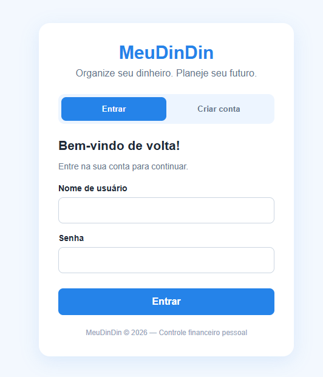
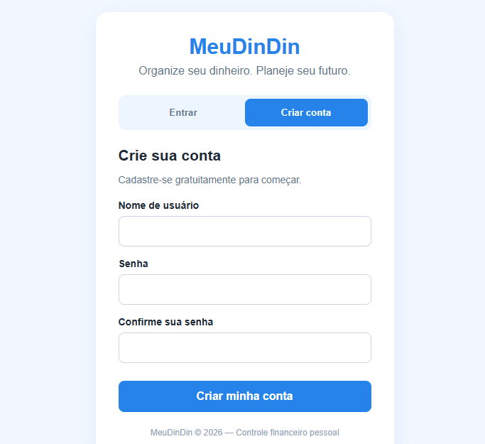
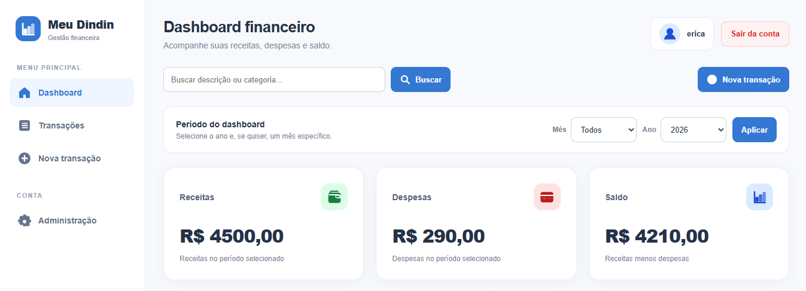
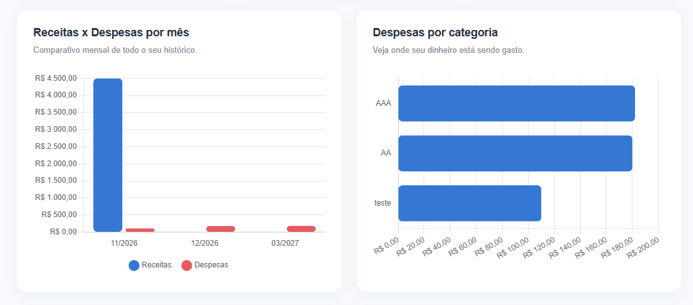
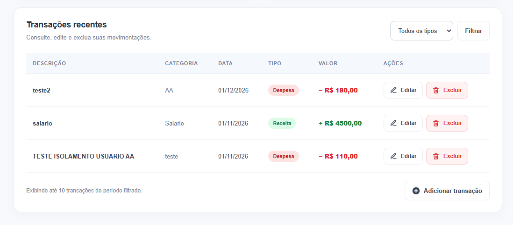
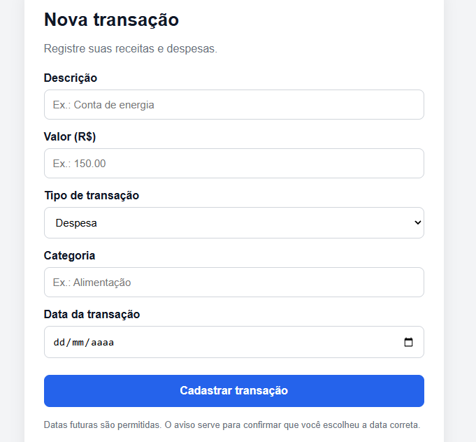

# **Meu DinDin | Controle Financeiro Pessoal**

Aplicação web que desenvolvi com Python e Django para facilitar o controle de receitas e despesas pessoais.

A proposta do Meu DinDin é oferecer uma ferramenta simples para organizar a movimentação financeira, acompanhar resultados em um dashboard e manter os dados de cada usuário separados.

**Acesse o sistema:** https://meudindin-b259.onrender.com/

---

## **Conheça o sistema**

### **1. Tela de login**

### **2. Cadastro de usuários**

### **3. Dashboard financeiro**

O painel apresenta informações sobre a movimentação financeira e permite acompanhar os resultados de forma visual.

### **4. Histórico de transações**

### **5. Cadastro de receitas e despesas**

---

## **Funcionalidades**

- Cadastro e autenticação de usuários.
- Aprovação manual de novos cadastros pelo administrador.
- Dashboard para acompanhamento financeiro.
- Registro de receitas e despesas.
- Consulta de movimentações por categoria e data.
- Separação dos dados financeiros entre diferentes usuários.
- API REST para operações financeiras.
- Documentação da API com Swagger.

---

## **Tecnologias utilizadas**

| Tecnologia | Aplicação no projeto |
|---|---|
| **Python** | Linguagem principal |
| **Django** | Desenvolvimento backend |
| **Django REST Framework** | Construção da API |
| **PostgreSQL** | Banco de dados |
| **HTML e CSS** | Interface da aplicação |
| **Git e GitHub** | Versionamento do código |
| **Render** | Hospedagem da aplicação |

---

## **Segurança e backup**

Um dos pontos que priorizei no desenvolvimento foi a separação dos dados entre os usuários. Cada conta possui suas próprias transações e não consegue visualizar as movimentações de outras contas.

Também implementei uma rotina de backup do PostgreSQL. Além da geração automática das cópias, realizei um teste de restauração em um banco local separado para verificar se os dados poderiam ser recuperados.

---

## **Sobre o desenvolvimento**

Este projeto faz parte da minha evolução prática com Python e desenvolvimento web.

Durante a construção do Meu DinDin, trabalhei com autenticação, controle de permissões, integração com banco de dados, desenvolvimento de APIs REST e publicação de aplicações.

O projeto também me proporcionou experiência com questões importantes do desenvolvimento de sistemas, como isolamento de dados, manutenção e recuperação de informações.

---

## **Desenvolvedor**

**Jonatas Balthazar Nascimento**

- **GitHub:** https://github.com/JohnBalth
- **LinkedIn:** https://www.linkedin.com/in/jonatas-balthazar-120298202

Projeto desenvolvido como parte do meu portfólio profissional, com foco em desenvolvimento backend utilizando Python e Django.